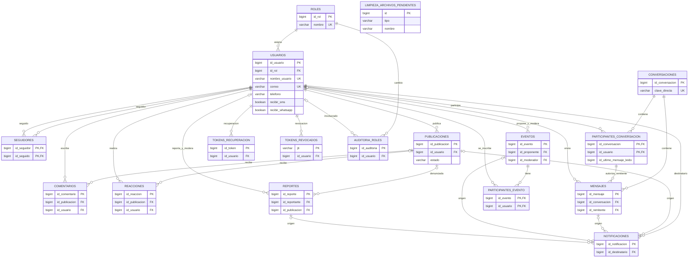

# Insectopia

**Red social para aficionados a los insectos.** Proyecto full stack de Programación Web que permite publicar fotografías y observaciones, comentar, reaccionar, seguir usuarios, intercambiar mensajes, organizar eventos y reportar contenido. Incluye funciones de moderación y administración.

**Repositorio GitHub:** https://github.com/AlejandroVicto/insectopia

## Tecnologías utilizadas

| Área | Tecnologías |
|---|---|
| Backend | Java 21, Spring Boot 4, Maven, Spring Security, JWT, Bean Validation, JPA/Hibernate |
| Frontend | React 19, Vite 8, React Router, Tailwind CSS, Axios |
| Base de datos | MySQL 8.4, Flyway |
| Pruebas | JUnit, Vitest, Bruno |
| Diseño | Figma |
| Comunicación | JavaMailSender, Twilio (SMS); WhatsApp pendiente de verificar |
| Despliegue requerido | VPS, Nginx, systemd, Let's Encrypt/Certbot y Postfix |

## Funcionalidades y roles

| Rol | Funciones principales |
|---|---|
| **USUARIO** | Publicaciones, comentarios, reacciones, seguimiento, mensajería, propuestas e inscripción a eventos y reportes |
| **MODERADOR** | Funciones de usuario y revisión de eventos y reportes |
| **ADMINISTRADOR** | Gestión de usuarios y roles, además de las funciones de moderación |

El acceso se realiza con **correo electrónico y contraseña**. El registro exige al menos 8 caracteres, una mayúscula, un número y un carácter especial, con validaciones en React y en los DTOs de Spring Boot. La seguridad utiliza JWT en el encabezado `Authorization: Bearer <token>`, BCrypt para contraseñas y rutas/permisos protegidos en backend y frontend.

## Base de datos y diagrama entidad-relación

- **Motor:** MySQL (no MariaDB).
- **Base de datos de ejemplo:** `insectopia_bd`. Configurar explícitamente `DB_NAME=insectopia_bd`; las plantillas incluidas usan `insectopia` como valor predeterminado.
- **Migraciones:** `backend/src/main/resources/db/migration/` (Flyway, V1–V11). Hibernate valida el esquema; no lo genera mediante `ddl-auto=create`.
- **Datos de prueba:** `backend/src/main/java/com/insectopia/seeders/DatabaseSeeder.java` (perfil `demo`; 15 usuarios, 15 publicaciones, 15 eventos y registros relacionados).
- **Respaldo SQL versionado:** [database/insectopia_modelo_nuevo_backup.sql](database/insectopia_modelo_nuevo_backup.sql) (respaldo histórico; pendiente validar/actualizar contra el esquema final).

El modelo incluye relaciones N:M mediante `seguidores`, `participantes_evento` y `participantes_conversacion`.

### Diagrama ER



## Instalación y ejecución local

**Requisitos:** JDK 21, MySQL 8.4, Node.js y npm compatibles con `frontend/package.json`, Git. Maven Wrapper está incluido.

1. Clonar el repositorio:

   ```powershell
   git clone https://github.com/AlejandroVicto/insectopia.git
   cd insectopia
   ```

2. Crear una base **vacía de desarrollo** en MySQL y un usuario de aplicación con permisos para Flyway. No borrar una base existente:

   ```sql
   CREATE DATABASE insectopia_bd CHARACTER SET utf8mb4 COLLATE utf8mb4_unicode_ci;
   ```

3. Copiar la configuración del backend y completar los secretos **solo localmente**:

   ```powershell
   Copy-Item backend/.env.example backend/.env
   ```

   En `backend/.env` establecer `DB_NAME=insectopia_bd`, `DB_USER`, `DB_PASSWORD` y un `JWT_SECRET` seguro en Base64. Revisar los demás valores de la plantilla. Existe además `backend/src/main/resources/application.properties.example` sin contraseñas reales. No subir `.env`, credenciales ni tokens a Git.

4. Las variables de `.env` deben estar disponibles en el **entorno del proceso**, ya que Maven no carga automáticamente ese archivo. Por ejemplo, desde PowerShell en la raíz del proyecto:

   ```powershell
   Get-Content backend/.env | ForEach-Object {
       $linea = $_.Trim()
       if ($linea -and -not $linea.StartsWith('#')) {
           $par = $linea -split '=', 2
           if ($par.Count -eq 2) {
               [Environment]::SetEnvironmentVariable($par[0].Trim(), $par[1].Trim(), 'Process')
           }
       }
   }
   cd backend
   .\mvnw.cmd spring-boot:run
   ```

   **Precaución:** Flyway aplica migraciones pendientes al iniciar; primero comprobar respaldos e historial de migraciones si no es una base nueva. Para datos ficticios puede utilizarse el perfil `demo` **solo en una base aislada**, nunca en producción.

5. Abrir otra terminal desde la raíz del repositorio y ejecutar React:

   ```powershell
   cd frontend
   npm install
   Copy-Item .env.example .env
   npm run dev
   ```

   Configurar `VITE_API_URL=http://localhost:8080` en `frontend/.env` y los flags mock en `false` si están presentes. El frontend normalmente abre en `http://localhost:5173`.

## Credenciales de evaluación

Cuentas **ficticias** definidas en el seeder de demostración:

| Rol | Correo | Contraseña de demostración |
|---|---|---|
| **ADMINISTRADOR** | `demo.marina.vega@insectopia.invalid` | `Demo1234!` |
| **MODERADOR** | `demo.iker.salas@insectopia.invalid` | `Demo1234!` |
| **USUARIO** | `demo.andres.mora@insectopia.invalid` | `Demo1234!` |

Estas cuentas se crean con el perfil `demo`; **su existencia en el VPS no está verificada**. La cuenta administradora de evaluación deberá estar disponible de forma controlada para la revisión, sin habilitar el seeder sobre datos de producción.

## URL base de la API

| Entorno | URL |
|---|---|
| Desarrollo local | `http://localhost:8080` |
| Salud de la API | `http://localhost:8080/api/health` |
| **API pública del VPS** | **Pendiente de URL HTTPS real y verificada** |

Ejemplos: `POST /api/auth/login` obtiene el JWT; `GET /api/auth/me` requiere el JWT; `GET /api/publicaciones` consulta publicaciones paginadas. Los filtros y la paginación se envían al backend.

## Pruebas de API con Bruno

La colección debe estar versionada en `backend/bruno/`. Al momento de esta revisión **no está integrada en `main`**: [PR #39 — colección Bruno, login JWT, petición protegida y errores 400/401](https://github.com/AlejandroVicto/insectopia/pull/39). Debe fusionarse y ejecutarse desde Bruno (no Postman) para aportar evidencias de login, uso del token y error intencional. No ejecutar sin revisar las peticiones que modifican datos.

## Diseño en Figma

[**Prototipo de Insectopia en Figma**](https://www.figma.com/design/nWV3gxDiGdnWfG9l0IPcid/Sin-t%C3%ADtulo?node-id=0-1&p=f&t=2GK9N1Sm3fWDMwFX-0)

La paleta utiliza verde oscuro como base (naturaleza y estabilidad) y verde lima para resaltar acciones e información relevante (crecimiento y biodiversidad). **Pendiente de verificar:** acceso público y navegación funcional del prototipo para los tres roles.

## GitHub Projects

**Enlace al tablero público:** **pendiente de agregar URL verificada**.

La rúbrica requiere un Project público y activo con columnas **Backlog, To Do, In Progress, In Review y Done**, además de commits descriptivos de ambos integrantes.

## Despliegue en VPS

| Requisito | Estado documentado |
|---|---|
| **URL HTTPS pública de Insectopia** | **Pendiente de agregar y verificar** |
| **URL base HTTPS pública de la API** | **Pendiente de agregar y verificar** |
| Frontend estático con Nginx, backend JAR con systemd y MySQL en VPS | Pendiente de verificación |
| Certificado Let's Encrypt/Certbot | Pendiente de verificación |
| Correo real mediante Postfix + SPF/DKIM | Pendiente de verificación |
| SMS disparado desde la aplicación | Prueba real de envío con Twilio Trial reportada |
| WhatsApp disparado desde la aplicación | Pendiente de implementación/verificación |

**Para la entrega final:** verificar que el sitio y la API respondan desde el VPS por HTTPS; incorporar sus URLs y el enlace público de Projects. Probar los tres roles y documentar las evidencias requeridas. Los nombres completos de ambos integrantes y número de equipo deben incluirse en la entrega de Classroom.
