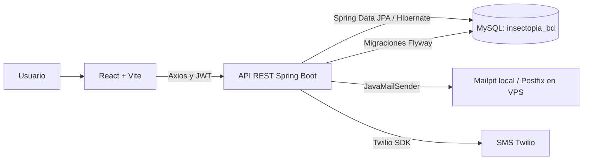
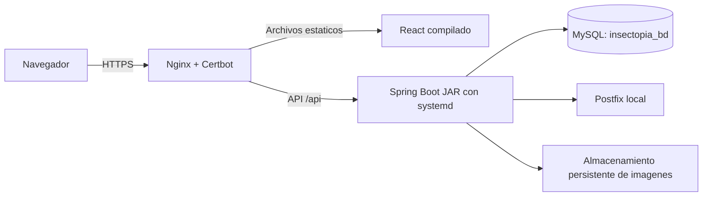

# Insectopia

**Red social para aficionados a los insectos — Proyecto de Programación Web.**

Insectopia reúne en una plataforma las observaciones y fotografías de insectos, publicaciones, comentarios, reacciones, seguimiento de usuarios, mensajería directa, eventos de observación, reportes y notificaciones. Cuenta con administración y moderación de contenido. Está dirigida a estudiantes, naturalistas y personas interesadas en la entomología.

**Repositorio:** https://github.com/AlejandroVicto/insectopia  
**Documentación principal:** este README reúne los requisitos de instalación, roles, base de datos, API, evaluación y despliegue; los contratos técnicos adicionales se encuentran en `backend/INTEGRACION_*.md`.  
**Estado:** aplicación desarrollada y probada localmente. No se ha verificado un despliegue público funcional en VPS con HTTPS, Postfix y WhatsApp.

## 1. Tecnologías utilizadas

| Capa | Tecnología | Versión / finalidad |
|---|---|---|
| Backend | Java, Spring Boot, Maven Wrapper | Java 21; Spring Boot 4.1.2; API REST |
| Seguridad | Spring Security, OAuth2 Client, JWT (JJWT), BCrypt | Autenticación, autorización por roles, OIDC de Google y contraseñas hasheadas |
| Persistencia | Spring Data JPA, Hibernate, Flyway | Repositorios, ORM y migraciones SQL |
| Base de datos | MySQL | 8.4; esquema `insectopia_bd` |
| Frontend | React, Vite, JavaScript | React 19.3.1; Vite 8.3.6 |
| Interfaz | React Router, Tailwind CSS | Rutas protegidas y estilos responsivos |
| Cliente HTTP | Axios | Comunicación con la API y envío de JWT |
| Correo | JavaMailSender, Mailpit | Recuperación de contraseña probada localmente |
| SMS | Twilio SDK | Notificaciones de inscripción; envío real probado en Trial |
| Pruebas | JUnit, MockMvc, Vitest, Bruno | Pruebas automáticas y colección de solicitudes API |
| Diseño | Figma | Prototipo de interfaz |
| Producción prevista | Nginx, Certbot, Postfix, systemd | Servidor web, HTTPS, SMTP y ejecución del JAR en VPS |

Las versiones de las dependencias se definen en `backend/pom.xml` y `frontend/package.json`. Node.js 24 y npm 11 son referencias del entorno de desarrollo, no versiones fijadas por `package.json`.

## 2. Arquitectura general



1. React muestra la interfaz y envía solicitudes HTTP a la API.
2. Spring Security verifica el JWT y los permisos antes de ejecutar operaciones protegidas.
3. Los controladores reciben DTOs y delegan la lógica de negocio en servicios.
4. Los servicios consultan repositorios JPA, que acceden a MySQL mediante Hibernate.
5. Flyway administra las modificaciones del esquema; Hibernate lo **valida**, pero no crea las tablas (`ddl-auto=validate`).

**Organización principal:**

```text
insectopia/
├── backend/
│   ├── src/main/java/com/insectopia/
│   │   ├── controllers/   # API REST y errores HTTP
│   │   ├── dtos/          # Solicitudes, respuestas y validaciones
│   │   ├── models/        # Entidades y enumeraciones JPA
│   │   ├── repository/    # Acceso a datos
│   │   ├── security/      # JWT y autorizaciones
│   │   ├── seeders/       # Datos de demostración
│   │   └── services/      # Reglas de negocio e integraciones
│   ├── src/main/resources/db/migration/  # Flyway
│   ├── src/test/          # Pruebas de backend
│   └── bruno/             # Colección Bruno pendiente de integrar a main (PR #39)
├── frontend/
│   ├── src/              # Páginas, componentes, rutas y servicios HTTP
│   └── public/           # Recursos públicos
├── database/             # Respaldos, diagramas y validaciones SQL
└── README.md             # Documentación de entrega y enlaces verificados
```

## 3. Usuarios, roles y funcionalidades

Insectopia utiliza tres roles almacenados en la tabla `roles`:

| Funcionalidad | USUARIO | MODERADOR | ADMINISTRADOR |
|---|:---:|:---:|:---:|
| Registrarse, iniciar/cerrar sesión y gestionar perfil | Sí | Sí | Sí |
| Publicar, comentar, reaccionar y seguir usuarios | Sí | Sí | Sí |
| Mensajería directa y notificaciones | Sí | Sí | Sí |
| Proponer eventos e inscribirse | Sí | Sí | Sí |
| Reportar publicaciones | Sí | Sí | Sí |
| Aprobar/rechazar eventos y resolver reportes | No | Sí | Sí |
| Gestionar cuentas, roles y auditoría | No | No | Sí |
| Acceder al panel `/moderacion` | No | Sí | Sí |
| Acceder al panel `/administracion` | No | No | Sí |

El acceso se controla realmente desde Spring Security y las reglas del backend; las rutas protegidas y componentes de React proporcionan una segunda capa de control visual. El inicio de sesión utiliza **correo electrónico**. El registro exige una contraseña de al menos ocho caracteres, con mayúscula, número y carácter especial, validada en frontend y backend.

## 4. Base de datos y diagrama entidad-relación

- **Motor:** MySQL 8.4 (no MariaDB).
- **Esquema usado en la instalación local documentada:** `insectopia_bd` (debe establecerse explícitamente `DB_NAME=insectopia_bd`; las plantillas `backend/.env.example` y `application.properties.example` tienen por defecto `insectopia`).
- **Usuario de MySQL:** `insectopia_user` (contraseña privada, no incluida en el repositorio).
- **Codificación:** `utf8mb4`, collation `utf8mb4_unicode_ci`.
- **Estructura:** 17 tablas de aplicación y `flyway_schema_history` (18 tablas físicas en total).
- **Migraciones versionadas en GitHub:** V1–V11. Según la última validación local documentada, V1–V10 se aplicaron sobre una base nueva y V11 de OAuth **no se había aplicado** a `insectopia_bd`; el estado actual de la base del VPS o de otros integrantes debe verificarse consultando `flyway_schema_history`.

Las tablas son `roles`, `usuarios`, `seguidores`, `publicaciones`, `comentarios`, `reacciones`, `conversaciones`, `participantes_conversacion`, `mensajes`, `notificaciones`, `eventos`, `participantes_evento`, `reportes`, `tokens_recuperacion`, `tokens_revocados`, `auditoria_roles` y `limpieza_archivos_pendientes`.

### Diagrama ER vigente (representación lógica)

El siguiente esquema procede de las migraciones consolidadas. Las imágenes PNG de `database/ER/` son referencias históricas que todavía requieren una nueva exportación desde la base actual.


Las relaciones muchos-a-muchos incluyen usuarios/usuarios mediante `seguidores`, usuarios/eventos mediante `participantes_evento` y usuarios/conversaciones mediante `participantes_conversacion`. Algunas referencias de historial aceptan `NULL` y usan `ON DELETE SET NULL`; esto permite conservar el registro sin conservar su referencia a un recurso eliminado.

### Migraciones Flyway V1–V11

| Migración | Contenido |
|---|---|
| V1 | Roles, usuarios, perfil, preferencias y restricciones |
| V2 | Seguidores |
| V3 | Publicaciones, comentarios, reacciones y reglas `SET NULL` |
| V4 | Conversaciones, participantes, mensajes e `id_ultimo_mensaje_leido` |
| V5 | Notificaciones |
| V6 | Eventos, inscripciones y referencias a eventos |
| V7 | Reportes y referencias a reportes |
| V8 | Tokens de recuperación y revocación |
| V9 | Inserción de `ADMINISTRADOR`, `MODERADOR` y `USUARIO` |
| V10 | Auditoría de roles y `limpieza_archivos_pendientes` |

Los cambios que antes estaban en **V11** se integraron en V4. Los de **V12** se integraron en V3, V6, V7 y V10. Esta consolidación es para **instalaciones nuevas**: no deben reutilizarse los SQL reescritos sobre bases que tengan un historial Flyway anterior sin preparar una migración específica.

**V11 nueva (Google OAuth):** `backend/src/main/resources/db/migration/V11__crear_identidades_oauth.sql` es una migración aditiva distinta de la V11 histórica ya consolidada. No modifica V1–V10 ni datos existentes; agrega `usuarios.acceso_local_valido` y crea cuatro tablas: `identidades_oauth`, `oauth_registros_pendientes`, `oauth_vinculaciones_pendientes` y `oauth_codigos_intercambio`. Los códigos y tokens sensibles se guardan como hash SHA-256. **No se ejecutó contra `insectopia_bd` durante este trabajo.** Flyway la aplicará automáticamente la próxima vez que arranque el backend con este código; por eso debe existir un respaldo verificado y revisarse el impacto antes de iniciarlo.

**Validación local realizada:** se creó una base vacía `insectopia_bd`; Flyway aplicó exitosamente las diez migraciones y Spring Boot inició con Hibernate/JPA. También se inspeccionaron claves foráneas con `ON DELETE SET NULL`. Sigue pendiente una comparación exhaustiva de esquema, índices y restricciones contra la base anterior.

## 5. Requisitos previos

- Java JDK 21.
- MySQL 8.4 y una cuenta administradora para preparar la base.
- Node.js y npm compatibles con `frontend/package.json` (referencia local: Node 24 y npm 11).
- Git.
- Maven Wrapper incluido en el proyecto; no hace falta instalar Maven globalmente.
- Opcional: DBeaver para administrar MySQL y Mailpit para probar el correo localmente.

## 6. Instalación y ejecución local

> **Importante:** sigue estos pasos en una instalación nueva o una base aislada. `main` contiene V1–V11 y la V11 de Google OAuth se puede aplicar al iniciar el backend. No apuntes una instalación actualizada a una base con migraciones antiguas modificadas sin respaldo y revisión de `flyway_schema_history`. No clones encima de una carpeta con cambios sin guardar.

### 6.1 Clonar el repositorio

En una carpeta nueva de trabajo:

```powershell
git clone https://github.com/AlejandroVicto/insectopia.git
cd insectopia
```

Si ya tienes el proyecto en `C:\laragon\www\insectopia`, **no necesitas volver a clonarlo**.

### 6.2 Crear la base de datos

Entrar a MySQL como administrador y ejecutar:

```sql
CREATE DATABASE insectopia_bd
  CHARACTER SET utf8mb4
  COLLATE utf8mb4_unicode_ci;
```

Si `insectopia_bd` ya existe, no ejecutar un borrado ni recrearla. **En `backend/.env`, establece explícitamente `DB_NAME=insectopia_bd`**: el nombre predeterminado de las plantillas es `insectopia`. Para un usuario MySQL ya existente con host `localhost`:

```sql
GRANT SELECT, INSERT, UPDATE, DELETE, CREATE, ALTER, DROP, INDEX, REFERENCES
ON insectopia_bd.* TO 'insectopia_user'@'localhost';
```

Si el usuario todavía no existe, créalo antes con una contraseña **nueva y privada** mediante una cuenta administradora. El host de la cuenta (`localhost` u otro) debe coincidir con el de la conexión real. Flyway creará las tablas; **no se importa un backup histórico para instalar la aplicación**.

### 6.3 Configurar el backend

Desde la **raíz del proyecto**:

```powershell
Copy-Item .\backend\.env.example .\backend\.env
```

Edita `backend/.env` y configura las variables necesarias, sin publicar secretos:

```dotenv
DB_HOST=localhost
DB_PORT=3306
DB_NAME=insectopia_bd
DB_USER=insectopia_user
DB_PASSWORD=<contraseña-privada>
JWT_SECRET=<clave-aleatoria-base64-de-32-bytes-o-mas>
JWT_EXPIRATION=86400000
APP_ENVIRONMENT=local
APP_FRONTEND_BASE_URL=http://localhost:5173
APP_API_PUBLIC_URL=http://localhost:8080
TWILIO_SMS_ENABLED=false
GOOGLE_OAUTH_ENABLED=false
GOOGLE_CLIENT_ID=<client-id-de-google-si-se-usa>
GOOGLE_CLIENT_SECRET=<secreto-de-google-si-se-usa>
GOOGLE_REDIRECT_URI=http://localhost:8080/login/oauth2/code/google
```

`GOOGLE_*` pertenece **solo al backend**. Nunca copies `GOOGLE_CLIENT_SECRET` al frontend ni a un archivo versionado. Con `GOOGLE_OAUTH_ENABLED=false`, o con cualquier credencial incompleta, no se registra el cliente OAuth: el backend sigue arrancando y el botón de Google aparece deshabilitado con una explicación.

Estas líneas son **una plantilla explicativa**; conserva las demás variables de `.env.example` y reemplaza los valores entre ángulos por los verdaderos valores locales. `JWT_SECRET` debe ser Base64 válido. Por ejemplo, para generar 32 bytes aleatorios en PowerShell sin mostrar la clave en pantalla:

```powershell
$rng = [System.Security.Cryptography.RandomNumberGenerator]::Create()
$bytes = New-Object byte[] 32
$rng.GetBytes($bytes)
[Convert]::ToBase64String($bytes) | Set-Clipboard
$rng.Dispose()
```

Pega el valor del portapapeles en `JWT_SECRET` dentro del archivo privado `.env`.

**El archivo `.env` no se carga automáticamente al iniciar Maven.** Desde la raíz, carga sus variables en la sesión PowerShell:

```powershell
Get-Content .\backend\.env | ForEach-Object {
    $linea = $_.Trim()
    if ($linea -and -not $linea.StartsWith('#')) {
        $partes = $linea -split '=', 2
        if ($partes.Count -eq 2) {
            $nombre = $partes[0].Trim()
            $valor = $partes[1].Trim()
            if ($nombre -match '^[A-Za-z_][A-Za-z0-9_]*$') {
                [Environment]::SetEnvironmentVariable($nombre, $valor, 'Process')
            }
        }
    }
}
```

Después verifica que `DB_NAME` se haya configurado como `insectopia_bd`, sin mostrar contraseñas:

```powershell
$env:DB_NAME
```

Compila y ejecuta el backend desde **`backend/`**:

```powershell
cd backend
.\mvnw.cmd -DskipTests compile
.\mvnw.cmd spring-boot:run
```

La API se inicia normalmente en `http://localhost:8080`. En la primera ejecución sobre una base vacía, Flyway aplica las migraciones versionadas V1–V11 y Hibernate valida las tablas. **Antes de arrancar sobre una base existente**, haz un respaldo verificado y revisa las migraciones pendientes.

**Modo demostración** (cargar datos ficticios con `DatabaseSeeder`): detén el backend anterior con `Ctrl+C` y, desde `backend/`, ejecuta:

```powershell
.\mvnw.cmd "-Dspring-boot.run.profiles=demo" spring-boot:run
```

`DatabaseSeeder` solo se activa con `@Profile("demo")`. No activar este perfil en producción.

### 6.4 Configurar y ejecutar el frontend

En **otra terminal**, desde la raíz del proyecto:

```powershell
cd frontend
npm install
Copy-Item .env.example .env
```

Comprueba en `frontend/.env`:

```dotenv
VITE_API_URL=http://localhost:8080
VITE_INICIO_MOCK=false
VITE_EVENTOS_MOCK=false
VITE_MENSAJES_MOCK=false
```

Conserva las demás variables de la plantilla según corresponda. Inicia React:

```powershell
npm run dev
```

Vite utiliza normalmente `http://localhost:5173`; confirma el puerto efectivo en su consola.

### 6.5 Direcciones de desarrollo

| Servicio | Dirección |
|---|---|
| Frontend React | `http://localhost:5173` (puerto habitual de Vite) |
| API Spring Boot | `http://localhost:8080` |
| Comprobación de salud | `http://localhost:8080/api/health` |
| Mailpit (interfaz) | `http://localhost:8025`, si el servicio está iniciado |
| Mailpit (SMTP) | `127.0.0.1:1025`, si el servicio está iniciado |
| Aplicación en producción | **Pendiente de URL HTTPS verificada** |
| API de producción | **Pendiente de URL pública verificada** |

## 7. Credenciales de prueba y administrador de evaluación

Las siguientes cuentas son **ficticias**, creadas por `DatabaseSeeder` exclusivamente con el perfil `demo`. Sus claves son públicas a propósito y **no son** las contraseñas de MySQL, VPS ni proveedores externos.

| Rol | Correo para iniciar sesión | Contraseña demo |
|---|---|---|
| **ADMINISTRADOR** | `demo.marina.vega@insectopia.invalid` | `Demo1234!` |
| **MODERADOR** | `demo.iker.salas@insectopia.invalid` | `Demo1234!` |
| **USUARIO** | `demo.andres.mora@insectopia.invalid` | `Demo1234!` |

El acceso se realiza mediante correo y contraseña, no mediante el nombre de usuario público. La cuenta administradora de evaluación tiene protecciones especiales en el backend. **Estas cuentas están definidas en el código, pero su existencia y funcionamiento en el VPS no están verificados.** Para evaluar en producción se necesitan cuentas de prueba aprovisionadas de forma controlada, con contraseñas de evaluación conocidas por el docente, sin ejecutar el perfil `demo` contra una base de producción ni afectar las cuentas de usuarios reales.

## 8. API REST y seguridad

**URL base local de la API:** `http://localhost:8080`  
**URL base de producción:** pendiente de aportar y verificar públicamente. No sustituir por `localhost` en la entrega.

Se utiliza autenticación con JWT. Las peticiones protegidas envían:

```http
Authorization: Bearer <JWT>
```

| Método | Endpoint | Descripción |
|---|---|---|
| `POST` | `/api/auth/register` | Registro de usuarios |
| `POST` | `/api/auth/login` | Login y obtención del JWT |
| `GET` | `/api/auth/me` | Información del usuario autenticado |
| `POST` | `/api/auth/logout` | Revocación del JWT |
| `POST` | `/api/auth/forgot-password` | Solicitar recuperación de contraseña |
| `POST` | `/api/auth/reset-password` | Restablecer contraseña |
| `GET` | `/api/health` | Salud del servicio |
| `GET` | `/api/publicaciones` | Publicaciones paginadas |
| `POST` | `/api/publicaciones` | Crear publicación |
| `GET` | `/api/conversaciones` | Listar conversaciones |
| `POST` | `/api/conversaciones/{id}/mensajes` | Enviar mensaje |
| `GET` | `/api/eventos` | Consultar eventos |
| `POST` | `/api/eventos` | Proponer evento |
| `POST` | `/api/eventos/{id}/participantes/me` | Inscribirse en un evento |
| `POST` | `/api/reportes` | Reportar contenido |
| `GET` | `/api/admin/usuarios` | Gestión administrativa de usuarios |
| `PUT` | `/api/usuarios/me/preferencias` | Consentimiento SMS/WhatsApp |

El backend emplea DTOs, Bean Validation, Spring Security y manejo global de excepciones. Las contraseñas se almacenan con BCrypt. Los códigos HTTP incluyen `200`, `201`, `204`, `400`, `401`, `403`, `404`, `409`, `422` y `500`, de acuerdo con la operación.

### 8.1 Acceso con Google (OAuth 2.0 / OpenID Connect)

**Estado:** implementado en backend y frontend, con pruebas enfocadas de compilación y comportamiento. **No se ha comprobado un inicio de sesión real contra Google** porque no hay credenciales autorizadas; por ahora no debe afirmarse que el flujo completo funciona en producción.

Se usa el starter oficial `spring-boot-starter-oauth2-client`, flujo **Authorization Code + OIDC** y únicamente los scopes `openid email profile`. No se solicitan permisos de Drive, Gmail, contactos ni ninguna otra API de Google.

#### Flujo

1. React consulta `GET /api/google/config`. Si Google no está configurado, el botón se deshabilita y se explica el motivo; el login con contraseña sigue disponible.
2. El botón lleva al backend a `/oauth2/authorization/google`. Spring Security genera el `state` y el `nonce`; la intención (`login` o `vinculacion`) y el token de vinculación se anexan como sufijo interno sin sustituir el `state` aleatorio.
3. Google redirige a `/login/oauth2/code/google`. Spring valida emisor, audiencia/client ID, firma, expiración, `state` y `nonce`. El backend exige `email_verified=true` y usa el `sub` estable como identidad del proveedor.
4. El backend aplica una de estas reglas:
   - `sub` ya vinculado → `LOGIN_COMPLETO`.
   - Correo local existente sin vínculo → `VINCULACION_REQUERIDA`; **nunca se vincula automáticamente**, aunque el correo esté verificado.
   - Correo nuevo → `REGISTRO_PENDIENTE`; no se crea el usuario hasta completar el formulario.
5. El callback devuelve al frontend un código opaco de intercambio: `/auth/google/resultado?code=...`. La página elimina `code`, `state` y `error` del historial con `replaceState` y envía el código por cuerpo a `POST /api/google/exchange`.
6. El intercambio entrega el **JWT de Insectopia** y los datos de usuario. El token de registro viaja únicamente en el `state` del router de React, nunca en la URL.

Los códigos de intercambio son aleatorios, de un solo uso y de corta duración. Sus hashes, los tokens de registro y los de vinculación se guardan en la base: no se almacenan JWT, tokens de Google, secretos ni contraseñas en claro. Las respuestas OAuth incluyen cabeceras `no-store`, `no-cache`, `Referrer-Policy: no-referrer` y `X-Content-Type-Options: nosniff`.

#### Configuración local

1. En Google Cloud Console, crear un cliente OAuth de tipo **Aplicación web**.
2. Registrar exactamente esta URI autorizada de redirección:

   ```text
   http://localhost:8080/login/oauth2/code/google
   ```

   Debe coincidir carácter por carácter con `GOOGLE_REDIRECT_URI`. En producción se reemplaza por la URL HTTPS definitiva y se agrega también en Google Cloud Console.

3. Completar en `backend/.env` las variables de la sección 6.3: `GOOGLE_OAUTH_ENABLED=true`, `GOOGLE_CLIENT_ID`, `GOOGLE_CLIENT_SECRET` y `GOOGLE_REDIRECT_URI`. No crear un `.env` en `frontend/`.
4. Antes de arrancar el backend con la nueva versión, respaldar y verificar `insectopia_bd`: Flyway detectará la nueva V11 y la aplicará automáticamente.
5. Iniciar backend y frontend como en la sección 6. Comprobar primero el estado deshabilitado; después, con las credenciales reales, verificar login para un correo nuevo, registro incompleto, vinculación manual desde Perfil → Seguridad, desvinculación y rechazo de una cuenta de evaluación/administradora.

#### JWT frente a Google

Google solo confirma una identidad externa. La sesión de la aplicación sigue siendo el JWT emitido por el backend, con la misma revocación, `versionToken`, roles y permisos por recurso que el login con contraseña. Los roles **nunca** se toman de Google: una cuenta nueva se crea transaccionalmente solo como `USUARIO` al enviar el formulario válido. La vinculación requiere sesión previa, pertenece al usuario autenticado, está ligada al `sub`, expira rápido y rechaza un `sub` ya usado por otra cuenta. Las cuentas administrativas/de evaluación no pueden vincular ni desvincular Google, y ninguna cuenta puede quedar sin un método de acceso válido.

#### Producción

Google exige HTTPS y orígenes/URI de redirección exactos para el dominio publicado. Configura `APP_FRONTEND_BASE_URL` y `GOOGLE_REDIRECT_URI` con el dominio HTTPS real, registra ese mismo valor en Google Cloud Console y no reutilices el cliente local. Mantén `GOOGLE_CLIENT_SECRET` únicamente en variables de entorno privadas del servidor.

## 9. Datos de demostración

El perfil `demo` ejecuta `DatabaseSeeder` después de Flyway. En una carga limpia se esperan los siguientes registros:

| Tabla | Registros |
|---|---:|
| `roles` | 3 |
| `usuarios` | 15 |
| `publicaciones` | 15 |
| `comentarios` | 30 |
| `reacciones` | 30 |
| `conversaciones` | 15 |
| `participantes_conversacion` | 30 |
| `mensajes` | 50 |
| `eventos` | 15 |
| `participantes_evento` | 30 |
| `seguidores` | 20 |
| `notificaciones` | 20 |
| `reportes` | 15 |
| `tokens_recuperacion`, `tokens_revocados`, `auditoria_roles`, `limpieza_archivos_pendientes` | 0 en una carga limpia |

Son **288 registros de aplicación**, incluidos los tres roles. Estos conteos corresponden al seeder y pueden variar después de utilizar la aplicación.

Para comprobar el historial de Flyway en DBeaver:

```sql
SELECT installed_rank, version, description, success
FROM insectopia_bd.flyway_schema_history
ORDER BY installed_rank;
```

La comprobación de integridad histórica está en `database/validaciones/039_validacion_integridad.sql`, pero requiere actualizarse para reflejar completamente el esquema consolidado de 17 tablas y las referencias opcionales.

## 10. Correo electrónico, SMS y WhatsApp

### Correo electrónico

- Spring Boot usa `JavaMailSender` para la recuperación de contraseña.
- **Mailpit fue probado localmente** como servidor SMTP de desarrollo; no equivale a la entrega a un buzón externo.
- **Pendiente:** instalar/configurar Postfix en VPS, definir SPF/DKIM y verificar la recepción real en un correo externo. También se revisará DMARC y la configuración DNS necesaria.

### SMS

- La aplicación utiliza **Twilio Trial** para enviar confirmaciones cuando un usuario se inscribe en un evento.
- **Se comprobó al menos una recepción real de SMS originado por Insectopia.**
- El envío requiere consentimiento `recibir_sms`, teléfono E.164, destinatario permitido y configuración válida de Twilio.
- El envío se solicita después de confirmar la transacción de inscripción; un fallo de Twilio no debe revertir la inscripción.
- El sistema no cuenta con un outbox durable para SMS; ante un reinicio pueden perderse tareas pendientes. Esta limitación está documentada.
- Los SMS se mantienen deshabilitados por defecto; solo se activan explícitamente en un entorno de pruebas autorizado.

### WhatsApp

La preferencia `recibir_whatsapp` existe, pero **el envío automático de WhatsApp desde la aplicación está pendiente**. No debe presentarse como funcionalidad terminada.

## 11. Pruebas de API con Bruno

**Herramienta exigida: Bruno (no Postman).** La colección existente cubre publicaciones, comentarios, reacciones, conversaciones y varios errores intencionales. Sin embargo, **la carpeta `backend/bruno/` no está presente en el árbol actual de `main`**.

Se preparó el [pull request #39](https://github.com/AlejandroVicto/insectopia/pull/39), todavía **abierto y sin fusionar** al momento de esta revisión. Incluye `24-login-jwt.bru` (`POST /api/auth/login` con obtención del token), `25-consultar-mi-sesion-jwt.bru` (`GET /api/auth/me` con JWT), `14-sin-jwt-denegado.bru` (HTTP 401), `26-login-invalido.bru` (HTTP 400), entorno `Local` y pasos de ejecución.

**Antes de la entrega:** integrar la colección en `main`, actualizar el repositorio local, abrir `backend/bruno` con Bruno, seleccionar `Local` y ejecutar individualmente las peticiones 24 → 25 → 14 → 26 contra una cuenta y un backend de pruebas. Las credenciales se configuran localmente y los JWT nunca se publican. Capturar las respuestas HTTP esperadas (200, 200, 401 y 400) ocultando secretos.

**Estado real:** existe la propuesta de corrección, pero **no debe marcarse este requisito como completado hasta que se integre y se pruebe en Bruno**. No ejecutar toda la colección indiscriminadamente, pues hay peticiones que crean o modifican datos de MySQL.

## 12. Diseño y prototipo de Figma

**Enlace al diseño:** [Prototipo de Insectopia en Figma](https://www.figma.com/design/nWV3gxDiGdnWfG9l0IPcid/Sin-t%C3%ADtulo?node-id=0-1&p=f&t=2GK9N1Sm3fWDMwFX-0).

La aplicación incluye pantallas de registro, login, inicio, publicaciones, eventos, mensajes, notificaciones, perfiles, configuración, moderación y administración. **Identidad visual:** la interfaz emplea fondos verde oscuro y acentos verde lima, asociados a naturaleza, biodiversidad y crecimiento; los tonos claros destacan controles y estados importantes sobre superficies oscuras. Esta es la justificación conceptual de la paleta, no una medición de accesibilidad. **Pendiente de verificar:** que el enlace permita ver un prototipo realmente navegable (no solo pantallas de diseño), que cubra los tres roles y que el contraste cumpla criterios de accesibilidad.

## 13. GitHub y GitHub Projects

**Repositorio público:** https://github.com/AlejandroVicto/insectopia

**Tablero de GitHub Projects:** **URL pública todavía no proporcionada ni verificada**. La opción `has_projects` del repositorio está habilitada, pero esto no demuestra la existencia de un tablero público activo ni sus columnas.

El tablero debe ser visible públicamente y reflejar tareas reales en las columnas **Backlog, To Do, In Progress, In Review y Done**. El historial de commits debe evidenciar el trabajo de los dos integrantes del equipo.

**Trabajo colaborativo:** comprobar que los commits publicados reflejen aportaciones reales de los dos integrantes y que el Project público muestre `Backlog`, `To Do`, `In Progress`, `In Review` y `Done`. Para cada actualización, revisar `git status` y el historial remoto; nunca versionar `.env`, credenciales, `target/`, `node_modules/`, `dist/` ni `uploads/`.

## 14. Respaldo SQL y restauración

Flyway permite construir el **esquema** de una instalación nueva; un respaldo SQL permite restaurar una **instantánea de estructura y datos**. No son equivalentes.

En `main` existe `database/insectopia_modelo_nuevo_backup.sql`, un respaldo histórico. **No se ha verificado** que represente fielmente el esquema actual V1–V11 ni que pueda restaurarse sobre una base aislada. El archivo `database/insectopia_backup.sql` no está publicado.

**Pendiente:** generar desde `insectopia_bd` un respaldo actualizado, por ejemplo `database/insectopia_bd_backup.sql`, incluyendo estructura y datos de demostración cuando corresponda, y comprobar su restauración en otra base aislada antes de considerarlo válido. En DBeaver se puede usar **Tools → Dump database**; según los permisos, `mysqldump` puede requerir `--no-tablespaces`.

No importar dumps antiguos encima de una base creada con Flyway V1–V10, pues pueden introducir estructuras y checksums históricos. Los respaldos con datos reales se almacenarán de manera privada y protegida; nunca se publicarán credenciales ni datos personales en GitHub.

## 15. Despliegue previsto en VPS

La docente requiere que Insectopia funcione desde el VPS con **frontend, backend y MySQL**, sobre HTTPS. No basta con ejecutarla localmente.

Arquitectura prevista:



Procedimiento general pendiente de ejecutar y verificar:

1. Preparar el VPS Linux y MySQL 8.4 con `insectopia_bd` y un usuario de aplicación con contraseña de producción distinta de la local.
2. Configurar secretos mediante variables de entorno privadas; no incluirlos en el repositorio.
3. Compilar el backend como JAR y ejecutarlo mediante `systemd`, sin perfil `demo`.
4. Generar el build de React mediante `npm run build` y servirlo con Nginx.
5. Configurar HTTPS mediante Let's Encrypt y Certbot.
6. Si se habilita Google, registrar la URI HTTPS exacta `https://<dominio>/login/oauth2/code/google` en Google Cloud Console y actualizar `GOOGLE_REDIRECT_URI`, `APP_FRONTEND_BASE_URL` y el origen autorizado. Nunca reutilizar el cliente de `localhost`.
7. Configurar Postfix, DNS de correo y entrega real.
8. Proteger y persistir directorios de imágenes, logs y respaldos.
9. Comprobar el acceso con los tres roles y documentar URL del sitio y URL base de la API.

**URL pública del sitio:** pendiente.  
**URL base pública de la API:** pendiente.

## 16. Estado del proyecto y pendientes

| Elemento | Estado actual |
|---|---|
| Backend Spring Boot y frontend React | Implementados localmente |
| Autenticación JWT y tres roles | Implementados |
| Google OAuth / OIDC | Implementado y cubierto por pruebas enfocadas; **sin prueba real con Google ni verificación en producción** |
| Migración V11 de OAuth | Creada; **no aplicada** a `insectopia_bd`; requiere respaldo verificado |
| Migraciones Flyway V1–V10 | **Aplicadas exitosamente en `insectopia_bd` vacía** |
| Hibernate/JPA | **Arranque validado contra el esquema nuevo** |
| Datos de demostración | Seeder implementado; comprobar conteos finales después de pruebas |
| Mailpit / recuperación de contraseña | **Probados localmente** |
| SMS Twilio | **Envío real desde Insectopia comprobado**; sin outbox durable |
| WhatsApp | **Pendiente de implementación y prueba real desde la aplicación** |
| Bruno | Colección ausente de `main`; PR #39 abierto con login/JWT/errores; integración y ejecución en Bruno pendientes |
| Diagrama ER Mermaid | Incluido; falta exportación gráfica actualizada |
| Comparación exhaustiva de esquemas | Pendiente |
| Respaldo SQL del esquema consolidado | Pendiente |
| Figma | Enlace incluido; navegación pública por verificar |
| GitHub Projects | URL pública pendiente |
| VPS, HTTPS y Postfix real | Pendientes de verificación y despliegue |
| Sincronización de GitHub con el estado local | No verificable para cada integrante; la revisión corresponde al árbol público de `main` |

## 17. Documentación complementaria y lista de entrega

El archivo `docs/GUIA_COMPLETA_INSECTOPIA.md` citado anteriormente **no está publicado en `main`**. La documentación de entrega principal es este README. Los detalles por módulo se pueden consultar en los contratos `backend/INTEGRACION_*.md` que sí estén versionados.

**Comprobaciones imprescindibles antes de la evaluación:**

- Incorporar la **URL pública verificable del tablero GitHub Projects** y comprobar sus columnas y actividad.
- Incorporar la **URL HTTPS real del sitio** y la **URL base pública de la API**; verificar VPS, Nginx, Certbot, JAR con systemd y MySQL.
- Verificar que el **administrador de evaluación** pueda entrar en el VPS sin activar el perfil demo sobre la base de producción.
- Completar y probar **Postfix + SPF/DKIM**, recepción real de correo y **envío automático de WhatsApp** desde la aplicación.
- Fusionar y ejecutar la **colección Bruno** en `main`, con evidencias de login, JWT protegido y error previsto.
- Generar un **respaldo SQL actualizado** sin datos personales y comprobar restauración en una base aislada.
- Verificar que el Figma compartido sea **navegable para los tres roles** y que ambos integrantes tengan commits propios.

Para Classroom: informar los nombres completos de ambos integrantes, el número de equipo, el enlace al repositorio, la URL HTTPS del sitio y la URL base pública de la API. No publicar datos personales o contraseñas reales en el README.

---

**Nota de entrega:** el README ya presenta la documentación técnica disponible, pero los requisitos marcados como pendientes requieren implementación, enlaces y evidencias reales. Ningún texto del README sustituye el despliegue, la recepción de correo, WhatsApp, la integración de Bruno ni las pruebas en vivo.
